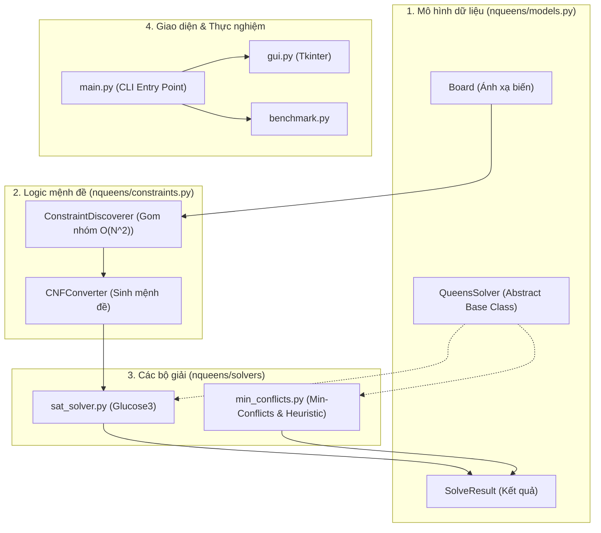

# Giải Thích Chi Tiết Thuật Toán & Mã Nguồn Task 1

Tài liệu này giải thích chi tiết từng hàm, từng khối code bên trong thư mục `AI_Task1/` (kèm theo mã nguồn tương ứng) và cung cấp cẩm nang trả lời phỏng vấn.

## Tổng Quan Kiến Trúc Dự Án



## Phần 1: Giải thích `nqueens/models.py`

File này định nghĩa các cấu trúc dữ liệu cơ bản và lớp trừu tượng (Interface) cho các bộ giải.

### 1. Lớp Board (Quản lý ánh xạ tọa độ và kiểm tra)

Chứa các hàm tiện ích để chuyển đổi giữa tọa độ `(r, c)` và số nguyên (DIMACS) dùng cho SAT Solver.

```python
class Board:
    """Bàn cờ N x N. Ô (r, c) ứng với biến mệnh đề X(r,c) = r*N + c + 1 (DIMACS, bắt đầu từ 1)."""
    def __init__(self, n: int):
        if n < 1:
            raise ValueError("N phải >= 1")
        self.n = n

    def var(self, r: int, c: int) -> int:
        return r * self.n + c + 1

    def cell(self, var: int) -> Tuple[int, int]:
        return divmod(var - 1, self.n)

    @property
    def num_vars(self) -> int:
        return self.n * self.n

    @staticmethod
    def count_attacking_pairs(queens: List[int]) -> int:
        """queens[c] = hàng của quân hậu ở cột c. Trả về số cặp hậu tấn công nhau."""
        n, cnt = len(queens), 0
        for a in range(n):
            for b in range(a + 1, n):
                if queens[a] == queens[b] or abs(queens[a] - queens[b]) == b - a:
                    cnt += 1
        return cnt

    @classmethod
    def is_valid(cls, queens: Optional[List[int]]) -> bool:
        return queens is not None and cls.count_attacking_pairs(queens) == 0
```

- `var(r, c)` / `cell(var)`: Chuyển đổi qua lại giữa ma trận 2D và mảng 1D cho PySAT.
- `is_valid()`: Hàm kiểm tra chéo (Double-check). Dù Solver trả về kết quả, ta vẫn dùng hàm này để đếm số cặp tấn công nhau, đảm bảo kết quả thực sự hợp lệ.

### 2. Lớp SolveResult và QueensSolver

`SolveResult` là dataclass dùng để đóng gói kết quả trả về. `QueensSolver` là lớp ABC (Abstract Base Class) định nghĩa Interface chung.

```python
@dataclass
class SolveResult:
    n: int
    solver: str
    solved: bool
    queens: Optional[List[int]] = None  # queens[c] = hàng của hậu ở cột c
    time_s: float = 0.0                 # thời gian giải (không gồm thời gian sinh CNF)
    steps: int = 0                      # số bước lặp (Min-Conflicts)
    num_vars: int = 0                   # số biến (SAT)
    num_clauses: int = 0                # số mệnh đề CNF (SAT)
    encode_time_s: float = 0.0          # thời gian sinh ràng buộc + CNF (SAT)
    info: dict = field(default_factory=dict)


class QueensSolver(ABC):
    name = "solver"

    @abstractmethod
    def solve(self, n: int) -> SolveResult:
        ...
```

## Phần 2: Giải thích `nqueens/constraints.py`

### 1. ConstraintDiscoverer: Thuật toán gom nhóm O(N²)

Thay vì kiểm tra từng cặp ô O(N⁴), code dùng Dictionary để nhóm các ô có cùng hàng, cột, hoặc đường chéo.

```python
class ConstraintDiscoverer:
    def __init__(self, board: Board):
        self.board = board

    def _group(self, key_fn) -> List[Tuple[Cell, ...]]:
        groups = {}
        n = self.board.n
        for r in range(n):
            for c in range(n):
                groups.setdefault(key_fn(r, c), []).append((r, c))
        return [tuple(v) for v in groups.values()]

    def discover(self) -> List[Constraint]:
        cons: List[Constraint] = []
        sources = {
            "row": lambda r, c: r,
            "col": lambda r, c: c,
            "diag": lambda r, c: r - c,
            "anti-diag": lambda r, c: r + c,
        }
        for name, fn in sources.items():
            for cells in self._group(fn):
                if name in ("row", "col"):
                    cons.append(Constraint("ALO", name, cells))
                if len(cells) >= 2:
                    cons.append(Constraint("AMO", name, cells))
        return cons
```

**Giải thích:**

Hàm `_group` duyệt qua toàn bộ bàn cờ O(N²), tính "khóa" (key) cho mỗi ô và nhóm chúng lại. `discover` sau đó duyệt qua các nhóm: nếu là hàng/cột thì sinh thêm ràng buộc ALO (phải có ít nhất 1 hậu), và nếu nhóm có từ 2 ô trở lên thì sinh ràng buộc AMO (không được có 2 hậu).

### 2. CNFConverter: Sinh mệnh đề CNF

Chuyển đổi các object `Constraint` thành mảng các số nguyên (định dạng DIMACS cho PySAT).

```python
class CNFConverter:
    def __init__(self, board: Board):
        self.board = board

    def iter_clauses(self, constraints: List[Constraint]) -> Iterator[List[int]]:
        v = self.board.var
        for con in constraints:
            lits = [v(r, c) for r, c in con.cells]
            if con.kind == "ALO":
                yield lits
            else:
                for a, b in combinations(lits, 2):
                    yield [-a, -b]
```

**Giải thích:**

Ràng buộc ALO `yield` ra một mảng gồm các số dương (mệnh đề OR). Ràng buộc AMO dùng `itertools.combinations` để tạo ra các cặp `(a, b)`, sau đó `yield` mảng `[-a, -b]` tương ứng với mệnh đề:

\[
(\neg x_a \lor \neg x_b)
\]

## Phần 3: Giải thích `nqueens/sat_solver.py`

### Bộ giải SAT (Glucose3)

Sử dụng thư viện PySAT để giải bài toán đã được mã hóa thành CNF.

```python
class SATQueensSolver(QueensSolver):
    name = "SAT (Glucose3)"

    def solve(self, n: int) -> SolveResult:
        board = Board(n)

        t0 = perf_counter()
        constraints = ConstraintDiscoverer(board).discover()
        clauses = CNFConverter(board).convert(constraints)
        encode_time = perf_counter() - t0

        t1 = perf_counter()
        queens = None
        with Glucose3(bootstrap_with=clauses) as solver:
            sat = solver.solve()
            model = solver.get_model() if sat else None
        solve_time = perf_counter() - t1

        if model:
            queens = [-1] * n
            for lit in model:
                if lit > 0:
                    r, c = board.cell(lit)
                    queens[c] = r
        solved = Board.is_valid(queens)
        return SolveResult(n, self.name, solved, queens, solve_time, 0,
                           board.num_vars, len(clauses), encode_time)
```

**Giải thích:**

Đầu tiên gọi `ConstraintDiscoverer` và `CNFConverter` để tạo mảng `clauses`. Đưa mảng này vào Glucose3. Nếu tìm được nghiệm (`model`), lọc các biến mang giá trị True (số dương), đổi ngược lại thành tọa độ `(r, c)` và lưu vào mảng `queens`.

## Phần 4: Giải thích `nqueens/min_conflicts.py`

### 1. QueenState (Đếm xung đột O(1))

Class quản lý trạng thái các quân hậu và 3 mảng đếm để tính xung đột cực nhanh.

```python
class QueenState:
    def __init__(self, n: int, rng: random.Random):
        self.n = n
        self.rows = [rng.randrange(n) for _ in range(n)]
        self.row_cnt = [0] * n
        self.d1 = [0] * (2 * n - 1)   # r - c + n - 1
        self.d2 = [0] * (2 * n - 1)   # r + c
        for c, r in enumerate(self.rows):
            self._add(c, r, 1)

    def _add(self, c: int, r: int, delta: int):
        self.row_cnt[r] += delta
        self.d1[r - c + self.n - 1] += delta
        self.d2[r + c] += delta

    def conflicts(self, c: int) -> int:
        r = self.rows[c]
        return (self.row_cnt[r] - 1) + (self.d1[r - c + self.n - 1] - 1) + (self.d2[r + c] - 1)

    def best_rows(self, c: int) -> List[int]:
        r0 = self.rows[c]
        self._add(c, r0, -1)
        n = self.n
        costs = [self.row_cnt[r] + self.d1[r - c + n - 1] + self.d2[r + c] for r in range(n)]
        self._add(c, r0, 1)
        m = min(costs)
        best = [r for r in range(n) if costs[r] == m]
        if len(best) > 1 and r0 in best:
            best.remove(r0)
        return best
```

**Giải thích:**

- `_add()`: Cập nhật mảng đếm khi thêm/bớt hậu (dùng chung cho lúc khởi tạo và di chuyển).
- `conflicts()`: Trả về số hậu khác đang tấn công hậu ở cột `c`. Trừ đi 1 ở mỗi mảng đếm vì không tính chính nó.
- `best_rows()`: Tạm gỡ hậu ra, tính chi phí `cost` cho tất cả các hàng, chọn hàng có chi phí `min`. Nếu hàng hiện tại `r0` cũng `min`, ta loại nó ra khỏi mảng `best` để tránh thuật toán "đứng yên".

### 2. MinConflictsSolver (Thuật toán chuẩn)

Vòng lặp chính của thuật toán Min-Conflicts.

```python
class MinConflictsSolver(QueensSolver):
    name = "Min-Conflicts"

    def select_variable(self, state: QueenState, conflicted: List[int]) -> int:
        return self.rng.choice(conflicted)

    def solve(self, n: int) -> SolveResult:
        max_steps = self.max_steps or max(10_000, 50 * n)
        t0 = perf_counter()
        state = QueenState(n, self.rng)
        steps, solved = 0, False
        while steps <= max_steps:
            conflicted = state.conflicted_columns()
            if not conflicted:
                solved = True
                break
            c = self.select_variable(state, conflicted)
            state.move(c, self.rng.choice(state.best_rows(c)))
            steps += 1
        elapsed = perf_counter() - t0
        return SolveResult(n, self.name, solved, list(state.rows), elapsed, steps)
```

**Giải thích:**

Vòng lặp `while` liên tục lấy danh sách các cột đang xung đột. Nếu danh sách rỗng, trả về `solved = True`. Nếu không, chọn 1 biến (`select_variable` - mặc định là random), và di chuyển hậu đến hàng ít xung đột nhất (`best_rows`).

### 3. MaxConflictMinConflictsSolver (Heuristic đề xuất)

Kế thừa lớp trên và ghi đè hàm chọn biến. Đây là điểm sáng của Requirement 3.

```python
class MaxConflictMinConflictsSolver(MinConflictsSolver):
    name = "Min-Conflicts + MaxConflict"

    def __init__(self, max_steps: Optional[int] = None, seed: Optional[int] = None, noise: float = 0.1):
        super().__init__(max_steps, seed)
        self.noise = noise

    def select_variable(self, state: QueenState, conflicted: List[int]) -> int:
        if self.rng.random() < self.noise:
            return self.rng.choice(conflicted)
        counts = [(state.conflicts(c), c) for c in conflicted]
        top = max(k for k, _ in counts)
        return self.rng.choice([c for k, c in counts if k == top])
```

**Giải thích:**

Thay vì chọn random hoàn toàn, hàm `select_variable` tung xúc xắc: nếu rơi vào 10% (`noise`), chọn ngẫu nhiên. Nếu rơi vào 90%, nó tìm cột có số xung đột (`conflicts`) lớn nhất (`argmax`) và ưu tiên sửa cột đó trước.